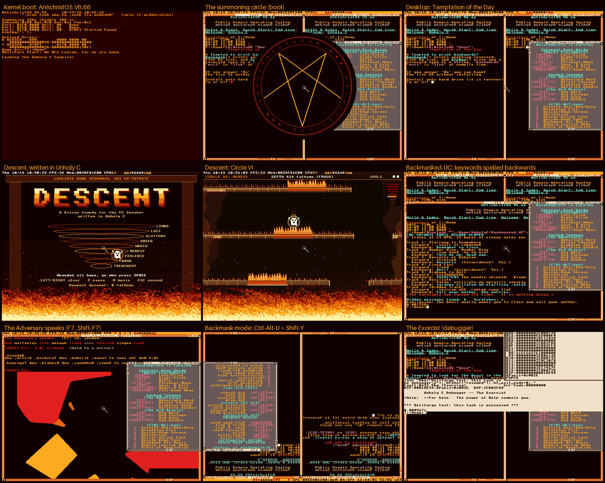

# AntichristOS V6.66

*SOtsirhcitnA, if you play it backwards.*

AntichristOS is a parody fork of **TempleOS V5.03**, the public-domain 64-bit operating system
written by Terry A. Davis. It is TempleOS played backwards. TempleOS framed itself as God's temple;
AntichristOS is Pandemonium's basement. The jokes come from heavy-metal album covers and the
satanic-panic era: backmasking, the tritone, 666, hellfire and Dante. They are aimed at nobody's
faith. The kernel, the compiler, the libraries and the games underneath are Terry's work and stay
in the public domain.



## What's inverted

| TempleOS | AntichristOS |
|---|---|
| HolyC | **Unholy C**. Every everyday keyword also works backwards (`fi`, `esle`, `elihw`, `rof`, `nruter`, `#edulcni` ...) or in metal (`summon`, `curse`, `forsake`, `sacrifice`, `tempt`/`repent`, `legion`). New inverse control flow: `unless`, `until` and `do ... until`, made by flipping the branch sense in the code generator rather than inserting a NOT. A `backwards "...";` statement prints its string reversed. `.UC` source files sit alongside `.HC`. Compile errors read `BLASPHEMY:` and warnings read `TEMPTATION:`. The prompt is `T:/Home<`. The shipped compiler was compiled by itself. |
| V5.03, "God's temple" | **V6.66**. The kernel banner prints a backmasked verse, `Summoning IRQs`, `We Are Legion, for we are many` and `Loading the Unholy C Compiler`. The tasks are `madA`, `hteS` and `Idle Hands`. |
| The debugger | **Unholy C Debugger: The Exorcist** ("The power of Help compels you"), with a tritone chime. |
| God's oracle (F7) | **The Adversary**: backmasked words, with TRUE BACKMASKs (god/dog, evil/live, devil/lived) highlighted; Bible passages "held to a mirror"; Diabolus songs in the Locrian mode and the tritone; a hellfire doodle. The old oracle still answers on F8 and F9. |
| Hymns | **Ctrl-Alt-R** backmasks all music, and Shift switches it to the Locrian mode. DoomBox plays any hymn in reverse. Psalmody gains Backmask, Invert and Play Backwards. |
| 16-color CGA | A **Hellfire** palette (Ctrl-Alt-I cycles Hellfire, Negative and Holy; Shift makes the fire breathe). **Ctrl-Alt-U** turns the screen upside down, with pixel-exact rot180 and the mouse compensated. **Ctrl-Alt-Y** switches to mirror-script and upside-down fonts. Pressing both gives backmask mode. Animated flames and 666 sit in the top bar, the pointer is a pitchfork, the window chrome is mirrored, and a summoning-circle splash plays at boot. |
| Tip of the Day, the Tour, the Charter | **Temptation of the Day**, **The Descent** (a tour through Dante's circles, plus a Number of the Beast part) and **The Anti-Charter**. The docs are rewritten in voice. |
| Games | **Descent**, a new game written in Unholy C: fall through the nine circles of Dante's Inferno. |

## Try it

Requirements: Windows or Linux with **QEMU** (`-machine pc`), **NASM**, and **Python 3** with **Pillow**.

```bash
python Hellforge/forge.py play
```

This builds `Hellforge/out/AntichristOS.ISO.C` and boots it in a QEMU window with PC-speaker sound
(WHPX if it is available, otherwise TCG). Answer `n` to the install prompt to play on the live CD. Some
things to try:

- **F7** / **Shift-F7**: the Adversary speaks.
- **F6**: a Diabolus song.
- **Ctrl-Alt-U** then **Ctrl-Alt-Shift-Y**: backmask mode.
- `#include "::/Apps/Descent/Run";`: play Descent.
- `#include "::/Demo/UnholyC/Backmasked.UC";`: a program written entirely in backmasked keywords.

## Hellforge, the build toolchain

TempleOS can only be compiled by TempleOS, so **Hellforge** (in `Hellforge/`, host side, not on the CD)
does it from the outside:

- `mkiso.py` is a pure-Python port of TempleOS's `RedSeaISO()`, with a NASM port of the El Torito stage-1 loader.
- `forge.py run FILE.HC` boots the tree in QEMU in about 10 s and runs Unholy C in the guest, with serial capture and screenshots.
- `forge.py bootstrap` rebuilds the kernel and compiler inside AntichristOS and copies them back out. Use `--stages 2` for a self-hosted fixpoint.
- `suite.py` runs the regression suite of guest tests in parallel.

See [Hellforge/README.md](Hellforge/README.md) and the design spec in [Hellforge/DESIGN.md](Hellforge/DESIGN.md).

## Known issue

The archive this repo was imported from stripped every 0x05 byte (and changed 0x1F to 0x20) in
DolDoc files, which damaged the sprites in 39 files (demos, games, the Personal Menu, a few docs).
Their sprite tails and the `StadiumBG.GR` picture now hold the original bytes from the TempleOS
V5.03 ISO, and the rebuilt `.MAP` files are clean again. The shift-spaces in the text of 152 files
and the AutoComplete dictionary are restored from the same ISO too. One shift-space, in a boot
message the fork rewrote, stays a space (see [Hellforge/README.md](Hellforge/README.md)). One
sprite, in `Demo/DolDoc/DemoDoc.DD`, is broken in V5.03 itself; Hellforge replaces it with an
empty one in the image.

## Credits

TempleOS was written by Terry A. Davis (1969-2018) and placed in the public domain. This fork
keeps all of his work public domain, and you can read his own words in `Doc/AboutTempleOS.DD` and
`Doc/Credits.DD`. The original archive is maintained at https://github.com/cia-foundation/TempleOS.
